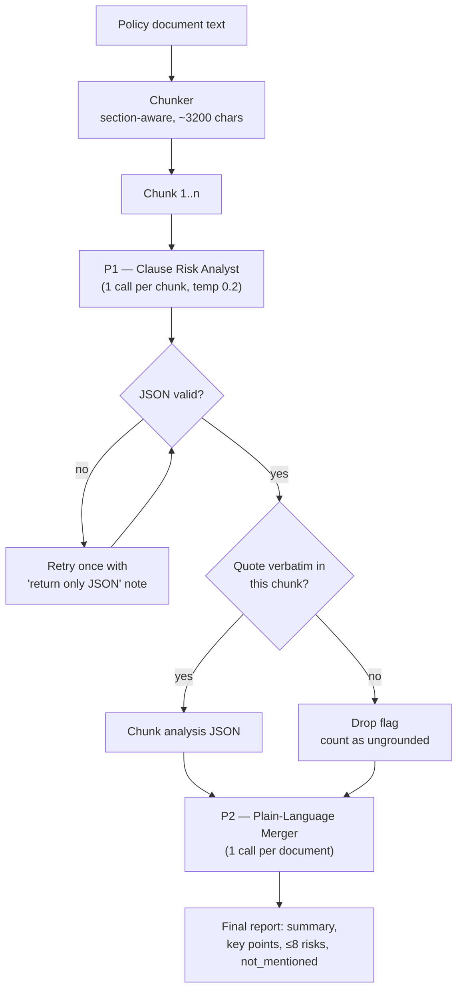
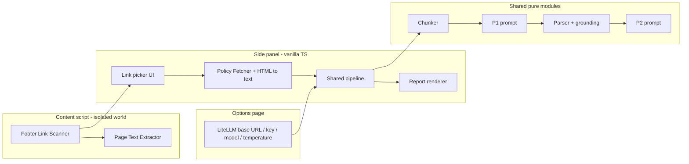
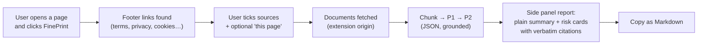
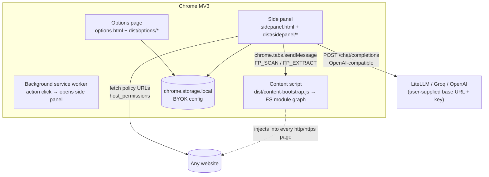

# FinePrint — Diagrams (Milestone 2, Section 2b)

Same four diagrams as `REPORT.md` §2(b), kept here as the standalone `docs/` copy. Mermaid source renders on GitHub; for the PDF, export these as images or paste the source into a mermaid renderer.

## 1 — Prompt workflow

## 2 — Task decomposition

## 3 — Input–output flow

## 4 — System architecture

*No agent loop or RAG pipeline: FinePrint does not use agents or retrieval — it is a deterministic two-prompt pipeline over the document's own text.*
